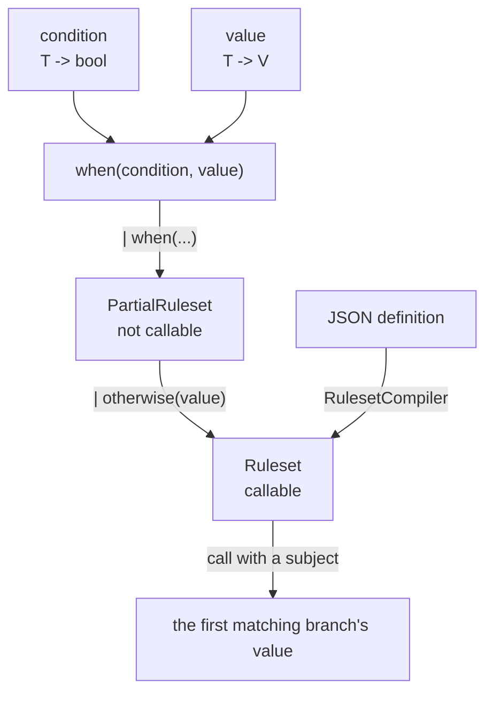

# User guide

pyruleset has a few pieces. Each page covers one of them with examples you can paste and
run (every `python` block in these docs is executed by the test suite).

| Piece | What it is | Page |
| --- | --- | --- |
| `when`, `otherwise`, `Ruleset` | branches tried in order, closed by a fallback | [Rulesets](rulesets.md) |
| `explain`, `decide` | which branch decided, for audit logs | [Deciding and explaining](explaining.md) |
| `PartialRuleset`, `\|` | overrides on top of a base policy | [Composing and overrides](composing.md) |
| `RulesetCompiler` | JSON definitions to rulesets | [Compiling from JSON](compiling.md) |
| `WhenCompiler` | `{"when": <ruleset>}` nodes inside values | [Rulesets inside values](nested.md) |
| `get_ruleset_json_schema`, `get_when_json_schema` | JSON Schema of the definitions | [JSON Schema](json-schema.md) |
| pyspecification, pyformula, pyflowstep | real conditions and values | [With the family](family.md) |

## The mental model

1. A **condition** is any callable `T -> Any`; a truthy result is a match.
2. A **value** is any callable `T -> V`. It is called with the same subject.
3. `when(condition, value)` makes one branch. `|` chains branches into a `PartialRuleset`.
4. `| otherwise(value)` closes the chain into a `Ruleset`, the only callable shape.
5. Calling a ruleset tries the branches in order and returns the first match's value.

Rulesets are frozen dataclasses: `|` always returns a new object, so a base policy can be
shared and extended without being changed.
