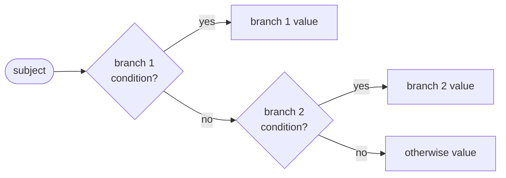

# pyruleset

**Conditional values: the first branch whose condition matches decides.**

Write a decision as a list of `when(condition, value)` branches closed by
`otherwise(value)`, chained with `|`. The result is a value you can call, explain, extend
with overrides, store as JSON and describe with JSON Schema.

```py
price = (
    when(is_gold(), subtotal * Decimal("0.80"), label="gold 20%")
    | when(items__ge(10), subtotal * Decimal("0.95"), label="bulk 5%")
    | otherwise(subtotal)
)
```

## A first taste

A courier company prices a parcel by where it goes and how heavy it is. The rules change
every season, and support staff keep asking "why was this parcel charged that much?".

```python
from dataclasses import dataclass
from decimal import Decimal

from pyruleset import otherwise, when


@dataclass(frozen=True)
class Parcel:
    country: str
    kg: Decimal
    express: bool = False


def domestic(parcel: Parcel) -> bool:
    return parcel.country == "SY"


def heavy(parcel: Parcel) -> bool:
    return parcel.kg > 20


def by_weight(rate: str):
    return lambda parcel: (parcel.kg * Decimal(rate)).quantize(Decimal("0.01"))


shipping = (
    when(heavy, lambda _: Decimal("95.00"), label="freight")
    | when(domestic, by_weight("1.20"), label="domestic per kg")
    | otherwise(by_weight("4.50"))
)

assert shipping(Parcel("SY", Decimal("3"))) == Decimal("3.60")
assert shipping(Parcel("DE", Decimal("2"))) == Decimal("9.00")
assert shipping(Parcel("DE", Decimal("25"))) == Decimal("95.00")
```

Branches are tried top to bottom and the first match wins, exactly like an
`if`/`elif`/`else` chain. Unlike one, the ruleset can tell you which branch decided:

```python
assert shipping.explain(Parcel("SY", Decimal("3"))) == "domestic per kg"
assert shipping.explain(Parcel("DE", Decimal("2"))) == "otherwise"
assert repr(shipping) == "Ruleset(freight | domestic per kg | otherwise)"
```

### Add a temporary rule without touching the base one

During a holiday campaign, express domestic parcels ship free. Put the new branch in front
of the base policy; when the campaign ends, drop it.

```python
def express_domestic(parcel: Parcel) -> bool:
    return parcel.express and domestic(parcel)


holiday = when(express_domestic, lambda _: Decimal("0.00"), label="holiday free express") | shipping

assert holiday(Parcel("SY", Decimal("3"), express=True)) == Decimal("0.00")
assert shipping(Parcel("SY", Decimal("3"), express=True)) == Decimal("3.60")
```

### Store it as JSON

The same policy can live in a database and be edited in an admin screen.
`RulesetCompiler` reads `{"branches": [...], "otherwise": ...}` and hands each `when` and
`then` to compilers you choose, so the expression languages stay yours.

```python
from pyruleset import RulesetCompiler

conditions = {"heavy": heavy, "domestic": domestic}


class Names:
    """Compile a condition by name: the smallest possible condition language."""

    def compile(self, name: str):
        return conditions[name]


class Rates:
    """Compile a value: a number is a flat price, {"per_kg": ...} a rate by weight."""

    def compile(self, definition):
        if isinstance(definition, dict):
            return by_weight(definition["per_kg"])

        return lambda _: Decimal(definition)


stored = {
    "branches": [
        {"when": "heavy", "then": "95.00", "label": "freight"},
        {"when": "domestic", "then": {"per_kg": "1.20"}, "label": "domestic per kg"},
    ],
    "otherwise": {"per_kg": "4.50"},
}

from_database = RulesetCompiler(Names(), Rates()).compile(stored)

assert repr(from_database) == repr(shipping)
assert from_database(Parcel("DE", Decimal("2"))) == Decimal("9.00")
```

In real projects the condition compiler is pyspecification's `PredicateCompiler` and the
value compiler pyformula's `FormulaCompiler`; see [With the family](guide/family.md).

## How a ruleset decides



Conditions after the matching one are never evaluated, and exactly one value is computed.

## Why not just `if`/`elif`?

For a decision that never changes, a plain `if` chain is fine. A ruleset earns its place
when the decision is **policy**:

<div class="grid cards" markdown>

- **Explainable.** `explain(subject)` names the branch that decided, for audit logs and
  support screens. [Deciding and explaining](guide/explaining.md)
- **Composable.** Overrides go on top of a base policy with `|`, and the base stays
  untouched. [Composing and overrides](guide/composing.md)
- **Safe by type.** A chain without `otherwise` cannot be called, so "no branch matched"
  never silently returns `None`. [Rulesets](guide/rulesets.md)
- **Data.** Store it as JSON, validate it with JSON Schema, and reject typos with their
  exact JSON path when an admin saves. [Compiling from JSON](guide/compiling.md)

</div>

## Part of a family

pyruleset only needs callables. It works with anything, and fits these packages by the
same author:

| Package | Gives you | Use it in a ruleset as |
| --- | --- | --- |
| [pyspecification](https://aaltatan.github.io/pyspecification/) | predicates combined with `&`, `\|`, `~` | conditions |
| [pyformula](https://aaltatan.github.io/pyformula/) | formulas with arithmetic operators | values |
| [pyflowstep](https://aaltatan.github.io/pyflowstep/) | flows of steps joined with `>>` | values: "pick a procedure and run it" |

None of them is a dependency of pyruleset.
